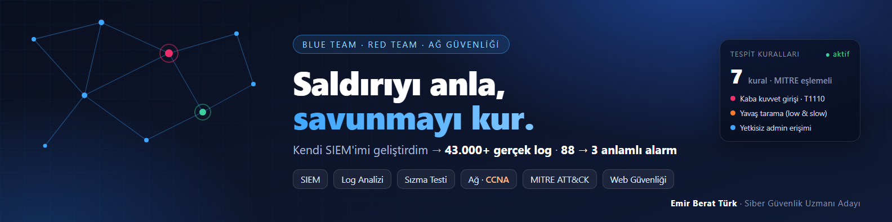

### Merhaba, ben Emir 👋

Bilişim Güvenliği Teknolojisi mezunuyum ve siber güvenlik alanında kariyerime başlıyorum. Hem savunma (Blue Team) hem saldırı (Red Team) tarafını öğreniyor, öğrendiklerimi gerçek projelerde uyguluyorum.

- 🛡️ **Şu an:** OzzAcademy'de Cisco CCNA · CEH Ethical Hacker (Red Team) · Siber Güvenlik Savunma (Blue Team) eğitimleri
- 🔎 **İlgi alanlarım:** SOC ve log analizi · tespit kuralları · sızma testi · ağ güvenliği
- 💼 **Açık olduğum roller:** SOC Analisti · Siber Güvenlik Uzmanı · Sızma Testi · IT Destek (junior)
- 📍 **İstanbul** · hemen başlayabilirim

> **EN:** Information Security Technology graduate starting a career in cybersecurity, learning both the defensive (Blue Team) and offensive (Red Team) side. I built a SIEM from scratch that runs on a real website's logs, and I write Python tools to automate my own work. Open to junior SOC, penetration testing and IT security roles in Istanbul.

## 📌 Projeler

### 🛡️ [Mini-SIEM](https://github.com/emirberatturk/mini-siem): güvenlik izleme sistemi

Gerçek bir web sitesinin 43.000+ log kaydıyla çalışan, sıfırdan geliştirdiğim SIEM.

- **88 alarm → 3 anlamlı alarm:** trafiğin %96'sının hosting firmasının aracı sunucusundan geldiğini log analiziyle bulup kuralları buna göre ayarladım
- **51 gün süren yavaş bir bot taramasını** ("low and slow") kısa pencereli kuralların kaçırdığı yerde yeni bir kuralla yakaladım
- **Üç tespit katmanı:** 7 davranış kuralı + 10 SigmaHQ imza kuralı + öğrenilmiş profille anomali tespiti. Etiketli CSIC 2010 veri setinde imzaların %4,2'lik yakalama oranı anomaliyle %37'ye çıktı (%99,96 doğruluk)
- **SIEM'in kendi güvenliği ve KVKK:** herkese zorunlu iki adımlı doğrulama (TOTP), roller, kişisel veri maskeleme, 90 gün saklama süresi (silinen kayıt dosyada iz bırakmaz)
- SOC arayüzü, olay raporu ve haftalık rapor · MITRE ATT&CK · 268 otomatik test

<table>
  <tr>
    <td></td>
    <td></td>
  </tr>
</table>

### 🌐 Kurumsal web sitesi ve yönetim paneli (serbest çalışma)

Bir sağlık kliniği için 3 dilli, mobil uyumlu web sitesi ve yönetim paneli (PHP, JavaScript).

- **Panel güvenliği:** şifrelerin hash'lenmesi, brute-force saldırılarına karşı hesap kilidi, formlarda hız sınırı, yüklenen dosyaların sunucuda doğrulanması
- **Gizlilik:** ziyaretçi çerez onayı vermeden harita gibi dış içerikler yüklenmez
- **Performans:** mobilde ağır 3D tedavi önizlemesi yalnızca ziyaretçi dokununca yüklenir

### 🎬 [video-kurgu](https://github.com/emirberatturk/video-kurgu): Python ile video otomasyonu

Türkçe konuşmalı ham çekimleri Instagram Reels için kurgulayan yerel bir araç: konuşmayı yazıya çevirir (faster-whisper), duraksamaları ve tekrarları keser, kelime kelime altyazı ekler, yüze göre dikey kadraj yapar; tanıtım videolarını da doğrudan koddan, 60 fps çizer (Mini-SIEM tanıtım videosu bununla yapıldı). Her şey bilgisayarda çalışır, videolar buluta gönderilmez. MIT lisanslı, açık kaynak.

## 🧰 Araçlar

             

## 📜 Sertifikalar ve kurslar

- Udemy: Sıfırdan Etik Hacker Olma (2026)
- Cisco Networking Academy: Introduction to Cybersecurity (2026)
- Exe-Academy: Sızma Testi, Kablosuz Ağ ve Sosyal Mühendislik (2025)
- BTK Akademi: Siber Güvenliğe Giriş · İşletim Sistemlerine Giriş · Bilgi Teknolojilerine Giriş (2024)

## 📫 İletişim

